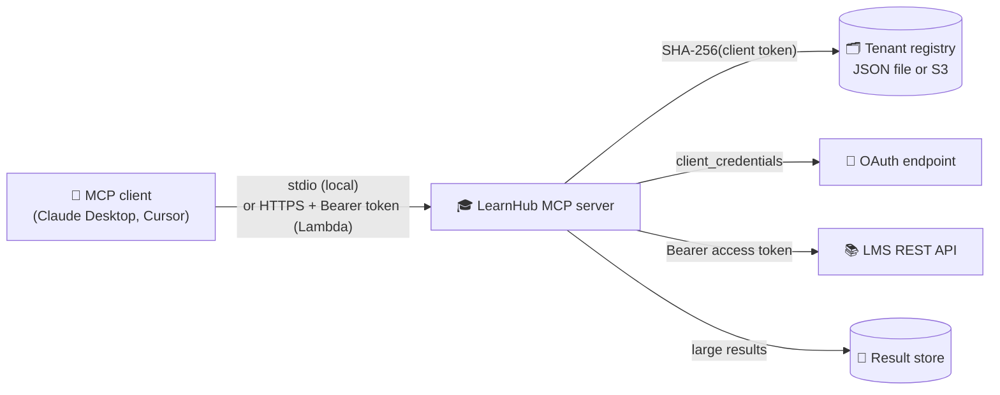

<div align="center">


# LearnHub MCP Server

### Let AI assistants talk to your LMS, safely.

A **multi-tenant [Model Context Protocol](https://modelcontextprotocol.io) server** that lets Claude, Cursor and any MCP client<br/>
answer questions about users, trainings and enrollments in plain language: locally, or on AWS Lambda.

<br/>

[](https://github.com/MedAmine-SUDO/learnhub-mcp-server/actions/workflows/tests.yml)
&nbsp;
[](LICENSE)


<br/>


</div>

<br/>

> 🎓 Based on the architecture of a production MCP server I designed and deployed for a European EdTech platform. This is a clean-room re-implementation against a fictional API; it contains no proprietary code or data.

<br/>

## ✨ Why LearnHub MCP?

*"Which learners haven't started the Security Bootcamp?"* *"List our instructors in Engineering."*
The answers live behind a paginated, rate-limited, OAuth-protected REST API. Turning that API into AI tools takes more than wrapping endpoints:

- 🏢 **Each customer may only see their own data.** One server, many tenants.
- 🔑 **AI clients must never hold upstream credentials.** They get an opaque client token, nothing more.
- 📚 **List endpoints return thousands of rows**, which would blow up a model's context window.
- 🚦 **The API enforces rate limits.** An eager AI agent can trip them in seconds.

**LearnHub MCP handles all four**, so the assistant only sees clean, safe, right-sized tools.

<br/>

## 🚀 Features

<table>
<tr>
<td width="50%" valign="top">

### 🏢 Multi-tenant by design
The tenant comes from a **SHA-256-hashed client token**, looked up server-side in a registry (JSON file or S3). It never comes from the model's input, so one tenant can't read another's records.

### 🔐 OAuth handled for you
Per-tenant client-credentials tokens are cached, **refreshed before they expire**, and retried once with a fresh token if the API answers 401.

### 🧠 Context-window protection
Small results come back inline. Big ones are stored and summarized (count, fields, 5-row preview, `result_id`), and the model pages through them only if it needs to.

</td>
<td width="50%" valign="top">

### 🚦 Rate-limit friendly
A per-tenant **sliding-window limiter** throttles requests *before* the API would answer 429. Transient failures are retried with exponential backoff and respect `Retry-After`.

### 🔌 One codebase, two transports
**stdio** for Claude Desktop and Cursor on your machine; **HTTPS JSON-RPC on AWS Lambda** for remote clients. Both share one `ToolService`.

### ✅ Schemas that can't drift
Tool input schemas are generated from **pydantic models**, so what the model sees and what the server validates are always the same. Unknown fields are rejected.

</td>
</tr>
</table>

<br/>

## ⚙️ How it works



1. **Tenant resolution.** The caller's client token is hashed with SHA-256 and looked up in a tenant registry (a local JSON file or an S3 object, cached with a TTL). Plain-text tokens are never stored.
2. **OAuth.** The server exchanges that tenant's client credentials for an access token, caches it per tenant, refreshes it before it expires, and retries once with a fresh token if the API answers 401.
3. **Rate-limited calls.** A per-tenant sliding-window limiter throttles requests *before* the API would answer 429. Transient failures (429 with `Retry-After`, 5xx, network errors) are retried with exponential backoff.
4. **Pagination.** List tools walk pages automatically up to the requested `max_results`.
5. **Context-window protection.** Small results come back inline. Large ones are written to a result store, and the model gets a summary instead: count, field names, a 5-row preview and a `result_id`. It can then page through the full result with `read_stored_result`.

<br/>

## 🛠️ Tools

| Tool | What it does |
| --- | --- |
| 👥 `list_users` | Users filtered by role, status, or name/email search |
| 👤 `get_user` | One user's profile |
| 📚 `list_trainings` | Trainings filtered by status or category |
| 📘 `get_training` | Training details with enrollment count and completion rate |
| 🎯 `list_training_participants` | Enrolled learners with progress, completion and score |
| 🗂️ `list_stored_results` | Large results saved during this session |
| 📄 `read_stored_result` | Page through a stored result (`offset`, `limit`) |

Every tool is **read-only** and says so through [MCP tool annotations](https://modelcontextprotocol.io/specification/2025-06-18/server/tools) (`readOnlyHint: true`, `destructiveHint: false`, `idempotentHint: true`, `openWorldHint: false`), along with a human-readable `title`. Clients can use these hints to run the tools without asking for confirmation each time.

Errors go back to the model as **tool errors** (`isError: true` plus a readable message), so the assistant can correct itself. A failed tool call doesn't break the session.

<br/>

## 🏁 Get started

Requires Python 3.11+ and [uv](https://docs.astral.sh/uv/).

```bash
git clone https://github.com/MedAmine-SUDO/learnhub-mcp-server.git
cd learnhub-mcp-server
uv sync --extra mock
cp .env.example .env

# Terminal 1: the mock LMS API on :8000
uv run learnhub-mock-api

# Terminal 2: replay the session shown above...
uv run python examples/demo_session.py

# ...or explore the server interactively
npx @modelcontextprotocol/inspector uv run learnhub-mcp
```

> 💡 The demo registry (`tenants.example.json`) has two tenants: `demo-token-acme` (320 users) and `demo-token-globex` (140 users). All data is fictional.

<details>
<summary><b>🖥️ Connect Claude Desktop</b></summary>
<br/>

```json
{
  "mcpServers": {
    "learnhub": {
      "command": "uv",
      "args": ["--directory", "/path/to/learnhub-mcp-server", "run", "learnhub-mcp"],
      "env": { "LEARNHUB_CLIENT_TOKEN": "demo-token-acme" }
    }
  }
}
```

Then ask Claude: *"Which learners haven't started the first Security training?"*

</details>

<br/>

## ☁️ Deploy to AWS Lambda

`lambda_handler.py` speaks MCP JSON-RPC over HTTPS: `initialize`, `ping`, `tools/list` and `tools/call`, plus notifications. The client token arrives as `Authorization: Bearer <token>` (or `X-Client-Token`). The service lives at module level, so warm invocations reuse cached OAuth tokens, the tenant registry and pooled connections.

```bash
./deploy/build_lambda.sh                       # -> build/lambda.zip (manylinux, Python 3.12)
sam deploy --template-file deploy/template.yaml --guided
```

Remote MCP clients then connect to the Function URL:

```json
{ "mcpServers": { "learnhub": { "url": "https://<id>.lambda-url.<region>.on.aws/",
                                  "headers": { "Authorization": "Bearer <client-token>" } } } }
```

<details>
<summary><b>🧪 Run the AWS side locally with Floci (no AWS account)</b></summary>
<br/>

[Floci](https://floci.io) is a free local AWS emulator. It runs Lambda functions as real containers and serves S3, so you can test the full remote path (S3 tenant registry, Lambda, OAuth, API) without an AWS account:

```bash
docker run -d --name floci -p 4566:4566 -v /var/run/docker.sock:/var/run/docker.sock floci/floci
MOCK_HOST=0.0.0.0 uv run learnhub-mock-api
./deploy/build_lambda.sh
uv run --extra s3 python deploy/deploy_floci.py
```

To point the stdio server at an S3 registry on Floci, set `LEARNHUB_TENANT_REGISTRY=s3://learnhub-config/tenants.json` and `AWS_ENDPOINT_URL=http://localhost:4566`.

</details>

<br/>

## 🔒 Security

| | |
| --- | --- |
| 🏢 **Tenant isolation** | The tenant is resolved from the client token on the server, never from tool arguments, and every upstream call uses that tenant's own OAuth token. |
| #️⃣ **Hashed client tokens** | The registry stores only SHA-256 hashes, compared in constant time. A leaked registry file holds no usable tokens. |
| 🔑 **No credentials for the AI** | Clients hold an opaque token. Upstream client secrets stay on the server and can be rotated without touching any client. |
| 👀 **Read-only tools** | No tool can create, change or delete LMS data, and every tool declares this through MCP annotations (`readOnlyHint`, `destructiveHint`). |
| 🛡️ **Validated inputs** | Pydantic validates every tool call and rejects unknown fields. `result_id` values are pattern-checked, so they can't escape the result store directory. |
| 🙈 **Safe errors** | The model sees readable error types and messages. Unexpected exceptions are logged server-side and returned as a generic error. |

<br/>

## 🧪 Tests

```bash
uv run pytest
```

The tests run the real mock API in-process through `httpx.ASGITransport`, so there's no network and nothing to start. They cover:

- ✅ tools end to end
- ✅ tenant isolation (one tenant can't read another's records)
- ✅ token caching and refresh, and 401 re-authentication
- ✅ 429 and 5xx retries, and the rate limiter (with an injected clock)
- ✅ result storage, paging and path-traversal protection
- ✅ the Lambda JSON-RPC transport, including tool titles and annotations

<br/>

## 🧰 Tech stack

| Layer | Technology |
| --- | --- |
| Protocol | Model Context Protocol · MCP Python SDK 2.x (stdio) · hand-rolled JSON-RPC handler (Lambda) |
| Core | Python 3.11+ · httpx (async) · pydantic 2 |
| Auth | OAuth 2.0 client credentials · SHA-256 hashed client tokens |
| Cloud | AWS Lambda (Function URL) · Amazon S3 · AWS SAM |
| Local AWS | Floci |
| Mock LMS | FastAPI · uvicorn |
| Tooling | uv · pytest · GitHub Actions |

<details>
<summary><b>Project structure</b></summary>
<br/>

```
├── src/learnhub_mcp/
│   ├── server.py          # MCP over stdio (local transport) + shared tool-error handling
│   ├── lambda_handler.py  # MCP JSON-RPC over HTTPS (Lambda Function URL)
│   ├── tools.py           # Tool specs (pydantic schemas, annotations) and handlers
│   ├── api_client.py      # LMS client: auth injection, rate limiting, retries, pagination
│   ├── auth.py            # OAuth client-credentials token manager
│   ├── tenants.py         # Hashed-token tenant registry (file or S3)
│   ├── rate_limit.py      # Sliding-window rate limiter
│   ├── result_store.py    # Large-result storage for context-window protection
│   └── runtime.py, config.py
├── src/mock_api/          # FastAPI mock LMS: OAuth, tenants, pagination, rate limits, fake data
├── deploy/                # Lambda build script, SAM template, Floci deploy script
├── examples/              # demo_session.py: a scripted MCP client session
├── tests/
└── .github/workflows/tests.yml
```

</details>

<details>
<summary><b>Design notes</b></summary>
<br/>

- **One service, two transports.** `ToolService` holds all the logic; stdio and Lambda are thin adapters over it.
- **Errors go to the model as tool errors** (`isError: true` plus a readable message), so the assistant can correct itself. A failed tool call doesn't break the session.
- **Lambda result storage uses `/tmp`**, which lasts only as long as a warm container. A multi-instance production deployment would put the result store on S3 with a lifecycle rule.
- **Secrets:** the demo registry holds client secrets inline for simplicity. In production, the registry should reference AWS Secrets Manager entries instead.

</details>

<br/>

## 🗺️ Roadmap

- [ ] Result store on S3 with a lifecycle rule, shared across Lambda instances
- [ ] Tenant registry entries that reference AWS Secrets Manager instead of inline secrets
- [ ] Switch the Lambda transport to the SDK's streamable-HTTP transport
- [ ] Per-tenant metrics (tool calls, latency, upstream errors) in CloudWatch
- [ ] More tools: certificates, learning paths, completion reports

<br/>

<div align="center">

Made with ☕ by [**MedAmine-SUDO**](https://github.com/MedAmine-SUDO)

If this helps you wire an API into your AI assistant, consider giving it a ⭐

</div>
