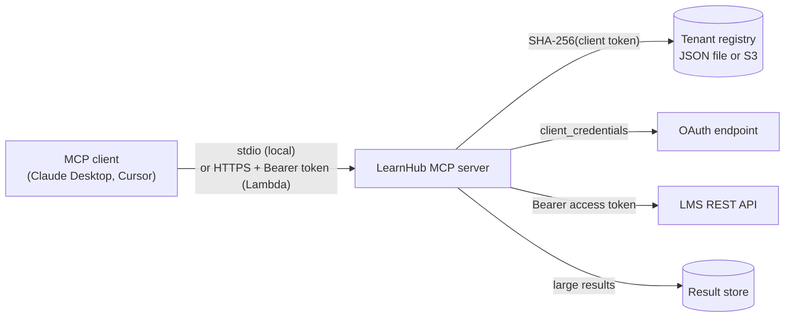

# LearnHub MCP Server

A **multi-tenant [Model Context Protocol](https://modelcontextprotocol.io) server** that lets AI assistants (Claude Desktop, Cursor, any MCP client) query a learning-management-system API in plain language: *"Which learners haven't started the Security Bootcamp?"*, *"List our instructors in Engineering"*.

It runs **locally over stdio** or **remotely on AWS Lambda** behind a Function URL, from the same codebase. It ships with a mock LMS API (LearnHub), so you can run the whole thing end to end in two commands.

> Based on the architecture of a production MCP server I designed and deployed for a European EdTech platform. This is a clean-room re-implementation against a fictional API; it contains no proprietary code or data.



## Why

LMS data lives behind a paginated, rate-limited, OAuth-protected REST API. Turning that API into AI tools takes more than wrapping endpoints:

- **Each customer may only see their own data.** One server, many tenants.
- **AI clients must never hold upstream credentials.** They get an opaque client token, nothing more.
- **List endpoints return thousands of rows**, which would blow up a model's context window.
- **The API enforces rate limits.** An eager AI agent can trip them in seconds.

## How it works



1. **Tenant resolution.** The caller's client token is hashed with SHA-256 and looked up in a tenant registry (a local JSON file or an S3 object, cached with a TTL). Plain-text tokens are never stored.
2. **OAuth.** The server exchanges that tenant's client credentials for an access token, caches it per tenant, refreshes it before it expires, and retries once with a fresh token if the API answers 401.
3. **Rate-limited calls.** A per-tenant sliding-window limiter throttles requests *before* the API would answer 429. Transient failures (429 with `Retry-After`, 5xx, network errors) are retried with exponential backoff.
4. **Pagination.** List tools walk pages automatically up to the requested `max_results`.
5. **Context-window protection.** Small results come back inline. Large ones are written to a result store, and the model gets a summary instead: count, field names, a 5-row preview and a `result_id`. It can then page through the full result with `read_stored_result`.

## Tools

| Tool | What it does |
|---|---|
| `list_users` | Users filtered by role, status, or name/email search |
| `get_user` | One user's profile |
| `list_trainings` | Trainings filtered by status or category |
| `get_training` | Training details with enrollment count and completion rate |
| `list_training_participants` | Enrolled learners with progress, completion and score |
| `list_stored_results` | Large results saved during this session |
| `read_stored_result` | Page through a stored result (`offset`, `limit`) |

Input schemas are generated from pydantic models, so what the model sees and what the server validates can't drift apart. Unknown fields are rejected.

## Quick start

Requires Python 3.11+ and [uv](https://docs.astral.sh/uv/).

```bash
uv sync --extra mock
cp .env.example .env

# Terminal 1: the mock LMS API on :8000
uv run learnhub-mock-api

# Terminal 2: replay the session shown above...
uv run python examples/demo_session.py

# ...or explore the server interactively
npx @modelcontextprotocol/inspector uv run learnhub-mcp
```

The demo registry (`tenants.example.json`) has two tenants: `demo-token-acme` (320 users) and `demo-token-globex` (140 users).

### Claude Desktop

```json
{
  "mcpServers": {
    "learnhub": {
      "command": "uv",
      "args": ["--directory", "/path/to/learnhub-mcp-server", "run", "learnhub-mcp"],
      "env": { "LEARNHUB_CLIENT_TOKEN": "demo-token-acme" }
    }
  }
}
```

## Remote deployment (AWS Lambda)

`lambda_handler.py` speaks MCP JSON-RPC over HTTPS: `initialize`, `ping`, `tools/list` and `tools/call`, plus notifications. The client token arrives as `Authorization: Bearer <token>` (or `X-Client-Token`). The service lives at module level, so warm invocations reuse cached OAuth tokens, the tenant registry and pooled connections.

```bash
./deploy/build_lambda.sh                       # -> build/lambda.zip (manylinux, Python 3.12)
sam deploy --template-file deploy/template.yaml --guided
```

Remote MCP clients then connect to the Function URL:

```json
{ "mcpServers": { "learnhub": { "url": "https://<id>.lambda-url.<region>.on.aws/",
                                  "headers": { "Authorization": "Bearer <client-token>" } } } }
```

### Run the AWS side locally with Floci

[Floci](https://floci.io) is a free local AWS emulator. It runs Lambda functions as real containers and serves S3, so you can test the full remote path (S3 tenant registry, Lambda, OAuth, API) without an AWS account:

```bash
docker run -d --name floci -p 4566:4566 -v /var/run/docker.sock:/var/run/docker.sock floci/floci
MOCK_HOST=0.0.0.0 uv run learnhub-mock-api
./deploy/build_lambda.sh
uv run --extra s3 python deploy/deploy_floci.py
```

To point the stdio server at an S3 registry on Floci, set `LEARNHUB_TENANT_REGISTRY=s3://learnhub-config/tenants.json` and `AWS_ENDPOINT_URL=http://localhost:4566`.

## Tests

```bash
uv run pytest
```

The tests run the real mock API in-process through `httpx.ASGITransport`, so there's no network and nothing to start. They cover:

- tools end to end
- tenant isolation (one tenant can't read another's records)
- token caching and refresh
- 401 re-authentication
- 429 and 5xx retries
- the rate limiter (with an injected clock)
- result storage and paging
- path-traversal protection
- the Lambda JSON-RPC transport

## Project layout

```
src/learnhub_mcp/
  server.py          MCP over stdio (local transport) + shared tool-error handling
  lambda_handler.py  MCP JSON-RPC over HTTPS (Lambda Function URL)
  tools.py           tool specs (pydantic schemas) and handlers
  api_client.py      LMS client: auth injection, rate limiting, retries, pagination
  auth.py            OAuth client-credentials token manager
  tenants.py         hashed-token tenant registry (file or S3)
  rate_limit.py      sliding-window rate limiter
  result_store.py    large-result storage for context-window protection
  runtime.py, config.py
src/mock_api/        FastAPI mock LMS (OAuth, tenants, pagination, rate limits, fake data)
deploy/              Lambda build script, SAM template, Floci deploy script
examples/            demo_session.py: a scripted MCP client session
tests/
```

## Design notes

- **One service, two transports.** `ToolService` holds all the logic; stdio and Lambda are thin adapters over it.
- **Errors go to the model as tool errors** (`isError: true` plus a readable message), so the assistant can correct itself. A failed tool call doesn't break the session.
- **Lambda result storage uses `/tmp`**, which lasts only as long as a warm container. A multi-instance production deployment would put the result store on S3 with a lifecycle rule.
- **Secrets:** the demo registry holds client secrets inline for simplicity. In production, the registry should reference AWS Secrets Manager entries instead.

## License

MIT
