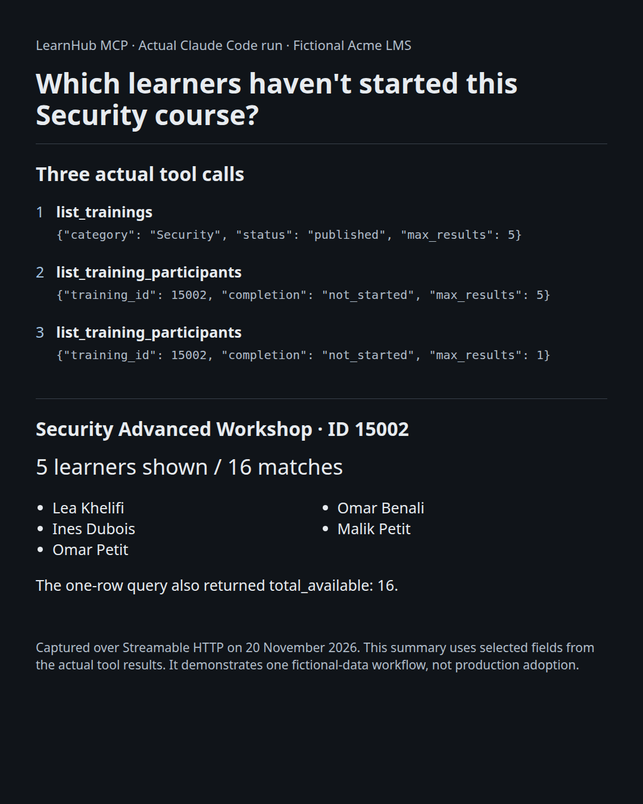
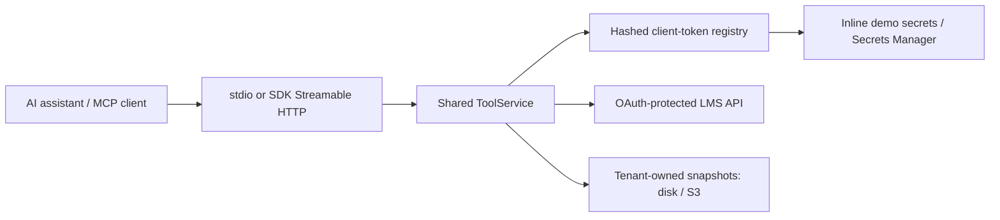

<div align="center">


# LearnHub MCP Server

**Let a training manager ask questions about their LMS from an AI assistant.**

Python · MCP SDK 2.x · stdio + Streamable HTTP · AWS Lambda · tenant-owned results

[](https://github.com/MedAmine-SUDO/learnhub-mcp-server/actions/workflows/tests.yml)
[](LICENSE)
</div>

> **Reference implementation, with fictional data.** Rebuilt from the architecture of an MCP server I designed and deployed for a European EdTech platform. No proprietary code, customer data or credentials are included. This repository is a starting point for an integration; it is not a connector to an existing commercial LMS.

Ask: **“Which learners haven't started a published Security course? Show five and tell me how many there are.”** The assistant can discover a course, filter its participants and answer from API data. It can follow up without receiving the whole learner directory.

[](docs/demo/assistant-workflow.mp4)

[Watch the captured assistant run](docs/demo/assistant-workflow.mp4) · [Inspect its tool transcript](docs/demo/transcript.json). The video records a live verification viewer of Claude Code events, not the Claude Desktop interface.

## Why this project

A useful MCP integration needs more than endpoint wrappers:

- Resolve the organization from a server-validated client token, never a model argument.
- Keep the upstream OAuth client credentials on the server.
- Handle pagination, expired OAuth tokens, transient errors and upstream rate limits.
- Return small results inline; store larger snapshots under their tenant and let the client page through them.
- Run the same tools over local stdio and the SDK's stateless Streamable HTTP transport.

**Who it is for:** SaaS engineers evaluating an MCP integration, and trusted training administrators trying the fictional LMS. The real deployment must apply its own authorization rules for learner data.

## Try the local demo

Requires Python 3.11+ and [uv](https://docs.astral.sh/uv/).

```bash
git clone https://github.com/MedAmine-SUDO/learnhub-mcp-server.git
cd learnhub-mcp-server
uv sync --locked --extra mock
cp .env.example .env

# Terminal 1: leave the fictional LMS API running
uv run learnhub-mock-api

# Terminal 2: an actual MCP client exercises the stdio server
uv run python examples/demo_session.py
```

Expected: initialize → 7 tools → inline users → a stored snapshot and page → training details → a denied cross-tenant user lookup. Acme has 320 fictional users; Globex has 140.

For the business workflow, run:

```bash
uv run python examples/training_manager_demo.py
```

This is a deterministic workflow check, not an LLM making decisions. The optional real-assistant runner and its captured evidence are described in [examples/README.md](examples/README.md).

### Connect Claude Desktop or Cursor over stdio

Keep the mock API running. Replace the absolute directory below. In Cursor put this in `.cursor/mcp.json`; in Claude Desktop use its MCP server configuration.

```json
{
  "mcpServers": {
    "learnhub": {
      "command": "uv",
      "args": ["--directory", "/absolute/path/to/learnhub-mcp-server", "run", "learnhub-mcp"],
      "env": {
        "LEARNHUB_CLIENT_TOKEN": "demo-token-acme",
        "LEARNHUB_TENANT_REGISTRY": "/absolute/path/to/learnhub-mcp-server/tenants.example.json"
      }
    }
  }
}
```

Ask the Security-course question above. Use `demo-token-globex` for the other organization. These public tokens are **demo credentials only**. For a graphical protocol inspector (requires Node.js/npm):

```bash
npx @modelcontextprotocol/inspector uv run learnhub-mcp
```

### Try Streamable HTTP

```bash
# Terminal 2, with the mock API still running
uv run learnhub-mcp-http
```

The endpoint is `http://127.0.0.1:8001/mcp`. It requires `Authorization: Bearer demo-token-acme` on every MCP request, including initialization. Health is at `/health`. A native client can use:

```json
{
  "mcpServers": {
    "learnhub": {
      "url": "http://127.0.0.1:8001/mcp",
      "headers": {"Authorization": "Bearer demo-token-acme"}
    }
  }
}
```

Client configuration formats vary. See the [verification matrix](docs/VERIFICATION.md) for what was actually exercised; do not infer that every assistant's hosted connector accepts this authentication method.

## Tools

| Tool | Purpose |
|---|---|
| `list_users` | Filter users by role, status or name/email |
| `get_user` | Retrieve one user's profile |
| `list_trainings` | Find courses by status or category |
| `get_training` | Retrieve a course and completion statistics |
| `list_training_participants` | Filter participants by completion status |
| `list_stored_results` | List unexpired snapshots owned by this organization |
| `read_stored_result` | Read a page from an organization-owned snapshot |

All tools are read-only with MCP annotations and Pydantic-generated input schemas. Annotations are client hints, not authorization. Errors are returned as tool errors so the assistant can explain or correct a failed request. `count` is the number fetched; `total_available` is the upstream matching count. Never present a capped list as a complete report.

## Architecture



The remote path uses the official MCP SDK, served by Starlette/Uvicorn or adapted to a Lambda Function URL with Mangum. Lambda enters a fresh ASGI lifespan per invocation: credentials and OAuth tokens can be fetched again. S3 snapshots survive changes of worker; `/tmp` affinity is not required.

## Adapt and deploy

- [Adaptation guide](docs/ADAPTATION.md): API contract, tenant setup, permissions and acceptance checks.
- [Deployment guide](docs/DEPLOYMENT.md): complete prerequisites, shared S3 snapshots, secret references, local AWS emulator, AWS commands, verification and teardown.
- [Security model](docs/SECURITY.md): trust boundary, token scopes, retention, limitations and operational controls.
- [Verification record](docs/VERIFICATION.md): tested paths and evidence.

**Changing the base URL alone does not adapt another LMS.** OAuth endpoints, REST paths, response envelopes and pagination must match or be adapted.

## Boundaries before using real data

- Client tokens represent trusted organization administrators; tokens for one organization share its snapshot namespace. This is not end-user SSO, row-level learner authorization or an OAuth authorization server for hosted assistant connectors.
- An optional `allowed_tools` list restricts a token's calls. Use a separate upstream credential with appropriately restricted access; tool allowlists do not implement field-level or row-level permissions.
- Use Secrets Manager references in the registry for production. Hashing the client token does not protect inline upstream secrets if the demo registry leaks.
- Local result storage is for one machine or a genuinely shared filesystem. Use S3 for Lambda/multiple machines. Snapshots expire after 24 hours by default; reads enforce expiry and a bucket lifecycle removes unvisited objects.
- The rate limiter is local to a service instance. It does not reserve a global quota across workers or other API consumers. Honor upstream 429 responses and add a shared quota mechanism if the workload needs one.
- Output thresholds apply to list responses. Detail records, previews and requested snapshot pages can still be large; an adapted API should expose narrow fields and server-side summaries.
- Use HTTPS outside localhost. Origin and Host allowlists are enabled, with no wildcard browser CORS. Configure exact trusted hosts/origins for your deployment.

## Development

```bash
uv sync --locked --extra aws --extra mock
uv run pytest -q
```

Tests cover tenant-owned snapshots, partial final pages, expiry, OAuth refresh, retries, permissions, deadlines, HTTP security, Lambda-shaped events and S3 request behavior. CI runs on Python 3.11 and 3.12. The build uses the locked dependencies with the AWS extra included.

## Working with me

I build and adapt MCP integrations for B2B SaaS teams: useful read-only workflows, tenant-aware access, deployment, verification and handover. LearnHub shows the approach; a pilot starts from your real API and permission model. [Contact Mohamed Amine Ben Afia](https://www.linkedin.com/in/mabenafia/).

MIT licensed. See [LICENSE](LICENSE).
